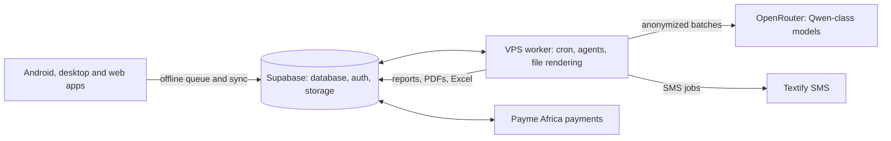
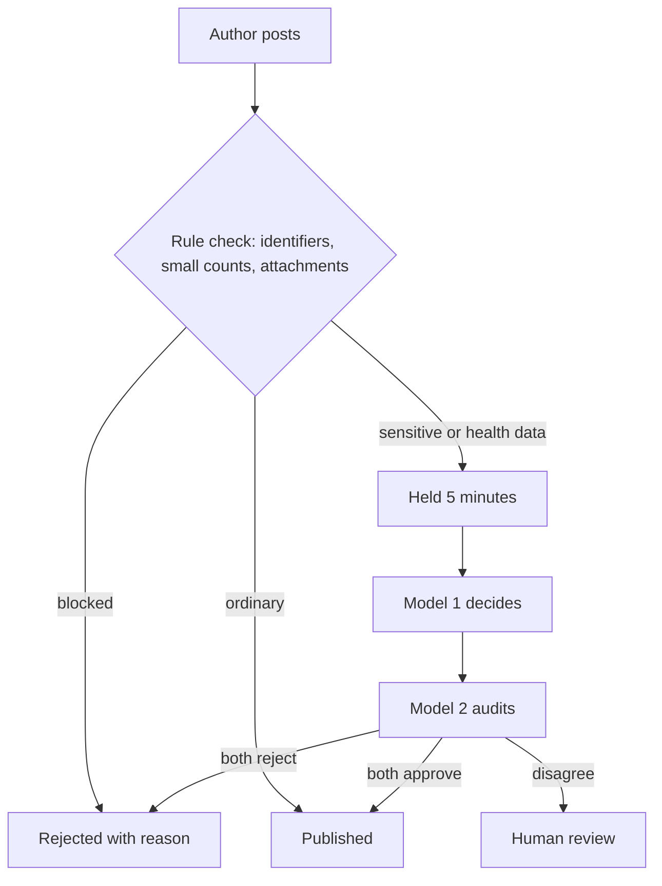

# KAMBi Blueprint

The social research tool for medical camps, outreaches and field studies. A ClerQ Intelligence product. First camp: 2 November 2026.

Kambi lets a team collect data in the field with or without signal, turns it into reports and follow-ups with AI, and connects the people doing this work through a small, well-moderated social layer. This blueprint lists every feature and how it gets built, in stages. Finish one stage, confirm its checklist, move on.

### Principles that hold in every stage

- Every collector action works offline and syncs later.
- A new volunteer registers a patient in under a minute without a manual.
- Patient identity never reaches an AI model. Raw records are never locked behind payment.
- One codebase: a web app wrapped for Android (Capacitor) and desktop (Tauri). Backend on Supabase plus one always-on VPS.
- Anything not stable at the freeze goes behind a feature flag instead of shipping half-working.

### How the pieces connect

## Stage 1: Foundation and access

Everything else stands on this.

**Make sure this is there**

- Accounts, login, roles: Admin, Supervisor, Collector, Viewer
- Events (fixed or rolling) with shareable adminship
- Collector invites by pasted emails, with search, approve-each table and in-app invitation notice
- Token links and QR codes as a fallback for people without email
- Consent step with timestamp, versioned terms and privacy policy
- Audit log of who created or changed what

**How.** Supabase Auth handles sign-in and magic links. Invites live in an *event_members* table with status (invited, approved, revoked). The admin pastes emails, a search function matches existing users, and the admin approves each row; approved users get a notification. Token links are separate rows with role, expiry and revoke. Row level security scopes every query to the event a person belongs to. An append-only audit table records every write. Terms are versioned, and any new use of personal data prompts a fresh opt-in, which keeps the door open for future features without breaking consent.

## Stage 2: Field capture

The part that must never fail on camp day.

**Make sure this is there**

- Drag and drop form builder with validation, skip logic and duplicate detection
- Starter templates by domain, plus a request-a-template button
- Offline capture with encrypted local storage, auto sync and a manual sync button
- Photos converted on the device: up to 1 MB each, 5 MB per entry; audio compressed the same way
- Device state and location collected as passive data, with opt-in
- Follow-up and referral queue
- Swahili and English interface

**How.** Forms are stored as versioned JSON schemas, rendered by one shared engine on every platform. Each field carries a tag: identifying or safe, set by the organizer. Entries are written to a local database first, then pushed in order with retry; the sync screen shows progress. Images are resized and recompressed in the client before upload. Location and device state are sampled in the foreground everywhere and in the background on Android and desktop only, because browsers cannot do it. Entry duplicates are flagged by key fields and merged by a supervisor. Lost-device protection: local data is encrypted and a remote lock takes effect at next connection.

## Stage 3: Portal, billing and messaging

Where organizers see progress and money moves.

**Make sure this is there**

- Live entries, per-collector counts, goals versus progress, trends, percentages and charts
- Heat maps and collector telemetry (online only)
- Raw export to CSV and Excel, always available
- Prepaid packages through Payme Africa, with refund of unused balance at event close
- Overage handling that never hides a patient record
- Textify SMS with character and segment counter and delivery status; push notifications and reminders

**How.** The dashboard reads aggregate views from Supabase and refreshes by realtime subscription. Telemetry plots timestamped location points into heat maps and per-person tracks, visible only to admins and only for opted-in sessions. Billing is a ledger: Payme webhooks credit an event wallet, each unique entry debits it, and the payer covers about 2 percent in fees. When the balance runs out, records keep saving and stay visible; SMS and AI outputs queue until top-up, with a small credit buffer and the final report released on settlement. Duplicates are not billed after merge. SMS jobs are queued on the VPS, counted in 160-character segments, and delivery receipts update the ledger.

## Stage 4: The AI engine

The VPS earns its monthly fee here.

**Make sure this is there**

- Field safety check, anonymization, and batch generation through a cheap Qwen-class model
- At event close, every output the admin selected arrives in the inbox at once; no regeneration
- About ten output types chosen at form creation: report, examination and assessment questions, follow-up questions, research proposal, grant template, newsletter article, investigative article and more
- Files delivered as PDF, Word, Excel and charts
- A compulsory system summary per event, deleted with the account
- A nightly personalized synopsis of related studies, delivered as a notification
- A blog and article publishing option

**How.** The VPS runs cron timers and a Postgres-backed job queue; jobs are idempotent and read an immutable snapshot of entries up to a timestamp. Step one classifies each field safe or unsafe, defaulting to unsafe and obeying the organizer's tags. Step two anonymizes: names and phones live in a separate locked table and never leave it, ages and places are generalized, free text is scrubbed, and photos never enter the AI path. Step three sends batches to the model, validates the structured output, then renders files with PDF, Word and Excel libraries and stores them in Supabase Storage. Every output is labeled as an AI-generated draft with a data-basis note. A generation costs roughly one to three cents, so limits protect against loops rather than cost. The nightly synopsis sends only topic keywords out, retrieves from real sources such as PubMed and OpenAlex, verifies each link, and shows only what was actually retrieved.

## Stage 5: The social research layer

Free for everyone. Three features only: feed, chats, forums.

**Make sure this is there**

- Feed with stories; chats (personal messages and groups); discussion forums
- Admins can publish findings, and anyone can write Medium-style articles
- In-app library for reading papers
- A recommendation job that refreshes feeds about every 30 minutes
- Pre-publish AI moderation for sensitive posts, report-driven review, and forum owners as moderators
- Block, mute, report and appeal controls from day one
- Spotify-style Wrapped recap in quota batches

**How.** Social tables sit in the same database, with realtime channels for chat. The recommender is a short Python script on cron that scores recent posts by topic overlap, follows, and freshness. Moderation works in layers, shown below. Rules run first and are deterministic: a post is blocked outright if it matches the locked identity table or contains small-cell counts that could re-identify someone. Sensitive or health posts wait five minutes while a first model decides and a second model audits that decision. If they agree, the VPS publishes or blocks; if they disagree, a human decides. Reports feed a second path: heavy reporting, such as more than half of viewers, hides the content and triggers a model review. Forum owners moderate their own spaces, with the models backing them up. Both model decisions and reasons are logged, and authors see why and can appeal. Wrapped ranks collectors by data quality as well as volume so rushing is not rewarded.

## Stage 6: Launch hardening

The week before the camp.

**Make sure this is there**

- Field test on real phones, fully offline, with a deliberately messy sync
- Training session, plus a test of how far a first-time user gets with no help
- Backups, failure alerts to your phone, a missed-batch catch-up on restart
- Per-entry cost log (tokens and SMS units) to confirm real margin
- Feature flags set: anything unstable stays hidden
- Written terms with the camp organizer, including what happens if turnout falls short

## After launch

- **Data marketplace.** Needs regulator assurance first. Listing a dataset requires organizer approval and a record of what each participant consented to. Terms are versioned and new uses need fresh opt-in.
- **Simulations** and **video capture**, once the core is proven.
- More output templates per domain, and an "ask your data" feature over anonymized aggregate views.

## Pricing and cost picture

| Item | Amount |
| --- | --- |
| Pilot price | 250 shillings per unique entry, prepaid |
| SMS | about 20 shillings each; 3 per entry is about 60 |
| AI per generation | roughly 1 to 3 US cents |
| VPS | about 5 to 7 US dollars a month |
| Social layer | free to users; cost is moderation tokens and storage |

Open decisions: what the three SMSs say and when they send; the exact list of ten output types per domain; retention after the access window; who owns raw exports once an event closes.

KAMBi, a ClerQ Intelligence product. Blueprint draft, October 2026.
