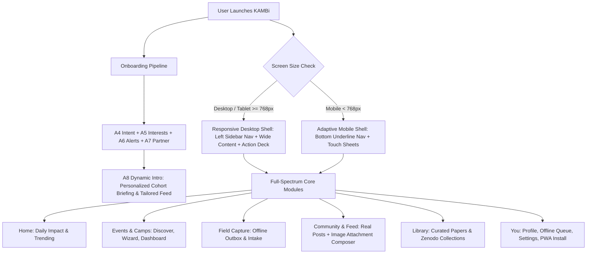

# KAMBi Platform Checkpoint: Architectural Audit & Remediation Plan

> **Checkpoint ID:** CHECKPOINT-13-AUDIT  
> **Status:** Critical Architecture & UX Review  
> **Scope:** Web App Responsive Shell, Dynamic Onboarding Personalization, Desktop PWA Support, Full-Spectrum Navigation, Community Feed & Image Composer  
> **Reference Specs:** `AGENT_RULES.md`, `docs/UI_DESIGN_PROMPT.md`, `docs/SCREEN_VALUE_MAP.md`, `docs/DESIGN_STACK_ROLES.md`

---

## 1. Executive Summary & User Gap Analysis

Following the recent checkpoint and user testing, several structural and functional shortcomings have been identified where the implementation fell short of the design principles and user expectations:

1. **Rigid Screen Dimensions (Mobile-Locked Shell):**  
   The application root (`MainApp.tsx`) and modal sub-screens were hardcoded with `max-w-md mx-auto`. On desktop monitors, laptops, and tablets, the UI displays as an unadapted 448px narrow vertical strip surrounded by empty voids. It fails to utilize available screen real estate with responsive sidebars, multi-column dashboards, and adaptive grid layouts.

2. **Disconnected, "Valueless" Onboarding:**  
   The user answers multi-step questions across `A4_Intent`, `A5_Interests`, `A6_Alerts`, and `A7_Partner`, but the final landing screen (`A8_Ready`) fails to synthesize or reflect these choices. It shows a static 75% ring and drops the user into an unpersonalized default state without explaining how their responses dynamically shaped their workspace.

3. **Missing Desktop PWA Installation:**  
   While mobile offline PWA caching is configured, there is no desktop PWA install trigger (`beforeinstallprompt`) or dedicated install flow in the navigation/settings for Chrome, Edge, and macOS/Windows laptop users.

4. **Siloed & Artificially Restricted Navigation:**  
   User navigation was previously partitioned into only three tabs based on intent (`tabDefs`), artificially locking users out of complementary features. An organizer could not browse the research Library, and a reader could not discover field camps or volunteer for data capture.

5. **Half-Baked Community & Absence of Feed Composer with Image Attachments:**  
   The Community section in `MainApp.tsx` was reduced to two static hardcoded mock cards. It lacked a functional interactive Feed (`E1_Feed`), feed composing capabilities (`E3_Composer`), image attachment/photo uploads from the field, topic tagging, and live user posting.

---

## 2. Core Design Principles & Constraints Review

Per `AGENT_RULES.md` and `docs/UI_DESIGN_PROMPT.md`:

* **Rule 6 (Shape & Chrome Restraint):**  
  * *No emojis in UI strings.*  
  * *No pill-shaped chip components.*  
  * *Use rows, segmented controls, and underline tabs.*  
  * Radii standards: 8px for controls, 14px for cards, 24px for sheets.
* **Dieter Rams / Jony Ive Restraint:**  
  * As little design as possible. Content is the hero, chrome recedes.
  * Neutral monochrome base (`#FFFFFF`, `#F6F6F4`, `#111111`, `#5B5B57`, `#E2E2DE`) with ember accent (`#D9501E`) reserved strictly for focal interactions (under 5% of screen surface).
* **Brand Asset Integrity:**  
  * Official vector logo mark (`/logo-symbol.svg`), ClerQ Intelligence brand mark (`/clerq-logo.png`), and official draw/dots loaders (`KambiLoader`).

---

## 3. Detailed Remediation Blueprint

### Module 1: Responsive Desktop & Mobile Adaptive Shell

* **Current Flaw:** `max-w-md mx-auto` hardcoded at root container level.
* **Architecture Fix:**
  * **Mobile (< 768px):** Keep the clean single-column mobile view with bottom underline tab bar.
  * **Desktop / Tablet (>= 768px):**
    * Expand to `max-w-6xl` or full-width fluid container.
    * Implement a persistent **Left Navigation Rail / Sidebar** showing all core sections: **Home**, **Events & Camps**, **Field Capture**, **Community Feed**, **Library**, and **You / Profile**.
    * Render multi-column layouts: main content stream on the left (65%), right-hand operational deck (35%) with quick outbox sync status, weather/network telemetry, and recent notifications.
    * Responsive grids for event cards, data tables, and metrics (`grid-cols-1 md:grid-cols-2 lg:grid-cols-3`).

### Module 2: Meaningful Dynamic Onboarding & Personalized Briefing

* **Current Flaw:** Disconnect between user answers and initial application state.
* **Architecture Fix:**
  * Pass onboarding state (`intent`, `interest_terms`, `region`, `partner_name`, `phone`) directly to `A8_Ready`.
  * **Dynamic Welcome Briefing in `A8_Ready`:**
    * Generates a tailored introduction based on their selections:
      * *For Health Researchers in Morogoro:* "Your workspace is configured for Health & Life Sciences in Morogoro Rural Zone. 3 active outreaches match your clinical profile."
      * *For Community Socializers:* "Your feed is tailored to Public Health and Agricultural Economics discussions."
    * Highlights personalized quick-actions immediately available upon entry.
  * **Personalized Home Feed:** Seeds Home and Community with articles and discussions matching their selected `interest_terms`.

### Module 3: Desktop PWA Installation Engine

* **Current Flaw:** No mechanism to trigger or guide desktop app installation.
* **Architecture Fix:**
  * Listen for the native `beforeinstallprompt` event in browser window.
  * Store the deferred prompt in a global hook / context (`usePwaInstall`).
  * Display an **"Install KAMBi for Desktop"** control:
    * In the desktop sidebar footer.
    * In the `J1_You` settings screen.
    * In the top bar when running uninstalled on Chrome, Edge, or Brave.
  * Clicking invokes `deferredPrompt.prompt()` and provides instant feedback when successfully installed as a standalone window.

### Module 4: Full-Spectrum Navigation (Unlocking Cross-Role Features)

* **Current Flaw:** 3 locked tabs based on intent; users cannot access other platform surfaces.
* **Architecture Fix:**
  * Unify navigation into a clean 5-tab system (mobile) and 6-item sidebar (desktop):
    1. **Home:** Daily summary, urgent field notices, personalized findings.
    2. **Camps & Events:** Discover camps, manage created events, team rosters.
    3. **Field Capture:** One-tap camera intake form, offline outbox, sync monitor.
    4. **Community Feed:** Public research discussions, field dispatches, real composer.
    5. **Library:** Citable research briefs, datasets, Zenodo exports.
    6. **You / Settings:** Profile, streak, partner badge, PWA install, security.
  * Intent sets the **default landing tab** and **featured widgets**, but **never hides or locks out other features**.

### Module 5: Community Feed with Image Attachment Composer (`E1_Feed` & `E3_Composer`)

* **Current Flaw:** Two static cards with no interactive composer or image upload capability.
* **Architecture Fix:**
  * Create `E1_Feed.tsx`: Live feed displaying author avatar, partner badge, timestamp, post text, high-resolution attached image, and interaction actions (like, discuss, share).
  * Create `E3_Composer.tsx`:
    * Multi-line text composer for field updates.
    * Image attachment support: file picker with instant preview, image removal, and local blob/storage caching.
    * Domain tag selector (Health, Agriculture, Markets, Infrastructure).
    * Offline queueing: If posted without signal, stores in IndexedDB outbox and syncs automatically when online.
    * Instant optimistic feed insertion.

---

## 4. Implementation Workplan & Milestones

| Step | Action Item | Target Files |
| :--- | :--- | :--- |
| **Step 1** | **Responsive Layout Shell** | Refactor `MainApp.tsx` with responsive desktop sidebar (`hidden md:flex`) + mobile bottom bar (`md:hidden`). Remove restrictive `max-w-md` limits for desktop viewports. |
| **Step 2** | **Desktop PWA Hook & Triggers** | Add `usePwaInstall.ts` handling `beforeinstallprompt`, add desktop install button in sidebar and settings. |
| **Step 3** | **Interactive Feed & Image Composer** | Build `E3_Composer.tsx` with image upload + local preview. Build interactive `E1_Feed.tsx` with live post creation and image rendering. |
| **Step 4** | **Dynamic Onboarding Briefing** | Refactor `A8_Ready.tsx` to synthesize answers into a personalized role briefing, pre-filtering the feed and dashboard. |
| **Step 5** | **Full-Spectrum Navigation** | Expose all core platform tabs (Home, Events, Capture, Community, Library, You) across all intent profiles. |
| **Step 6** | **Build & Quality Assurance** | Run full TypeScript typecheck (`pnpm -r build`), verify on mobile and desktop viewports, commit and deploy. |

---

## 5. Verification Checklist

- [ ] Desktop screens (1024px, 1280px, 1440px) render a spacious, multi-column dashboard with persistent left sidebar.
- [ ] Mobile screens (< 768px) retain the focused touch-optimized layout with bottom underline navigation.
- [ ] Answering onboarding questions actively customizes the landing briefing in `A8_Ready` and seeds initial feed topics.
- [ ] Users can compose a community feed post, attach an image/photo, select a domain, and see it published immediately in the feed.
- [ ] PWA install prompt triggers properly on desktop Chrome/Edge with dedicated UI buttons.
- [ ] All features (Events, Capture, Library, Community) are accessible regardless of chosen onboarding intent.
- [ ] Zero emojis in UI strings; zero pill chips (all tags adhere to 8px/14px radii standards per Rule 6).
- [ ] `pnpm build` passes with exit code 0.
